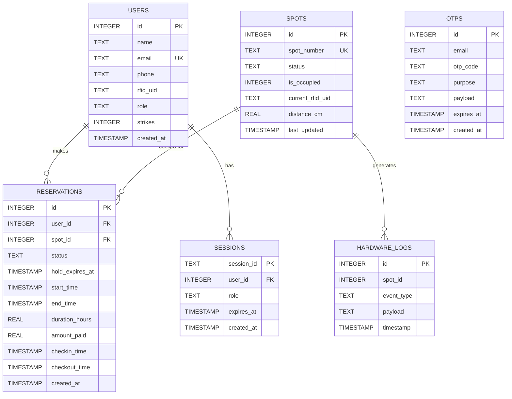

# ParkPulse Database Architecture & Schema

This document details the database infrastructure and schema for the ParkPulse Smart Parking System. You can use this for your DBMS project review.

## 1. Database Infrastructure

- **RDBMS Engine**: **SQLite3**
- **Architecture**: Embedded, serverless, file-based (`parkpulse.db`).
- **Journal Mode**: **WAL (Write-Ahead Logging)** 
  - Enabled via `PRAGMA journal_mode=WAL;`
  - *Why?* WAL allows concurrent readers and writers, significantly improving performance and preventing `database is locked` errors when hardware sensors update data concurrently with web API users.
- **Foreign Keys**: Enforced at the engine level using `PRAGMA foreign_keys=ON;`.
- **Query Factory**: Uses `sqlite3.Row` for dict-like row access, enabling easier integration with FastAPI Pydantic models.

---

## 2. Entity-Relationship (ER) Diagram

---

## 3. Schema Definitions

### `users` Table
Stores registered users, including admins and regular customers.
- `id` (INTEGER, **PRIMARY KEY**): Auto-incremented unique user ID.
- `name` (TEXT, NOT NULL): Full name of the user.
- `email` (TEXT, **UNIQUE**, NOT NULL): Email address, used for login and OTPs.
- `phone` (TEXT): Contact number.
- `rfid_uid` (TEXT, NOT NULL): The UID of the physical RFID card. *(Note: The UNIQUE constraint was removed here to allow sharing of testing cards for demos).*
- `role` (TEXT, NOT NULL, DEFAULT 'user'): Role-based access control (`admin` or `user`).
- `strikes` (INTEGER, DEFAULT 0): Penalty points (e.g., if a user overstays or fails to check-in).
- `created_at` (TIMESTAMP, DEFAULT CURRENT_TIMESTAMP)

### `spots` Table
Represents physical parking spots mapped to hardware IR sensors.
- `id` (INTEGER, **PRIMARY KEY**)
- `spot_number` (TEXT, **UNIQUE**, NOT NULL): Label for the spot (e.g., 'Spot 1').
- `status` (TEXT, NOT NULL, DEFAULT 'AVAILABLE'): Logical state (`AVAILABLE`, `HOLD`, `OCCUPIED`, `MAINTENANCE`).
- `is_occupied` (INTEGER, DEFAULT 0): Boolean (0 or 1) representing *physical* presence detected by IR hardware.
- `current_rfid_uid` (TEXT): The RFID tag currently occupying the spot (null if empty).
- `distance_cm` (REAL, DEFAULT 0.0): Raw distance measurement from the ultrasonic sensor.
- `last_updated` (TIMESTAMP)

### `reservations` Table
Tracks all lifecycle events of a parking booking. **(Core Transactional Table)**
- `id` (INTEGER, **PRIMARY KEY**)
- `user_id` (INTEGER, NOT NULL): **FOREIGN KEY** referencing `users(id)`.
- `spot_id` (INTEGER, NOT NULL): **FOREIGN KEY** referencing `spots(id)`.
- `status` (TEXT, NOT NULL, DEFAULT 'HOLD'): Booking state (`HOLD`, `ACTIVE`, `CANCELLED`, `COMPLETED`).
- `hold_expires_at` (TIMESTAMP, NOT NULL): Timeout for the 15-minute checkout payment window.
- `start_time` (TIMESTAMP): Selected reservation start window.
- `end_time` (TIMESTAMP): Selected reservation end window.
- `duration_hours` (REAL, DEFAULT 1.0): Total duration booked.
- `amount_paid` (REAL, DEFAULT 20.0): Payment collected in INR.
- `checkin_time` (TIMESTAMP): When the RFID tag was physically swiped for entry.
- `checkout_time` (TIMESTAMP): When the car physically left the spot.
- `created_at` (TIMESTAMP)

### `sessions` Table
Manages secure authentication without JWT overhead.
- `session_id` (TEXT, **PRIMARY KEY**): Cryptographically secure random UUID token.
- `user_id` (INTEGER, NOT NULL): **FOREIGN KEY** referencing `users(id)`.
- `role` (TEXT, NOT NULL, DEFAULT 'user'): Cached user role.
- `expires_at` (TIMESTAMP, NOT NULL): Expiry time for the cookie session (usually 24 hours).
- `created_at` (TIMESTAMP)

### `otps` Table
Handles transient data for email-based login and registration verification.
- `id` (INTEGER, **PRIMARY KEY**)
- `email` (TEXT, NOT NULL): Target email.
- `otp_code` (TEXT, NOT NULL): 6-digit verification code.
- `purpose` (TEXT, NOT NULL): Action type (`login` or `signup`).
- `payload` (TEXT): JSON-encoded string holding transient sign-up data (name, rfid) until verified.
- `expires_at` (TIMESTAMP, NOT NULL): Usually 10-15 mins from issue.

### `hardware_logs` Table
Audit trail / historical data for all physical sensor actions.
- `id` (INTEGER, **PRIMARY KEY**)
- `spot_id` (INTEGER): ID of the physical spot.
- `event_type` (TEXT, NOT NULL): Type of event (`SENSOR_UPDATE`, `RFID_SWIPE`, `PAYMENT_EXPIRED`, etc.).
- `payload` (TEXT): Detailed JSON of the event data.
- `timestamp` (TIMESTAMP, DEFAULT CURRENT_TIMESTAMP)

---

## 4. Key Design Decisions to Highlight to Your Prof:

1. **Separation of Physical and Logical State**: 
   Notice how the `spots` table has both a `status` (`AVAILABLE` / `HOLD`) AND an `is_occupied` (0 / 1) field. This is crucial for IoT. A spot can be logically `HOLD` (reserved online) but physically empty (`is_occupied=0`) until the user actually arrives.
2. **Stateless OTP Flow via Payload Column**:
   During signup, we store the user's intended Name and RFID in the `payload` JSON column in the `otps` table. They aren't inserted into `users` until the OTP is successfully verified, preventing junk records in the main `users` table.
3. **Session Cookies over JWTs**:
   Using a persistent `sessions` table allows for instant server-side invalidation/logout, a limitation of pure stateless JWTs.
4. **Write-Ahead Logging (WAL)**:
   SQLite usually locks the entire DB file for writes. By enabling WAL, the backend can serve multiple frontend read requests while the ESP32 hardware concurrently spams sensor updates to `spots`.
